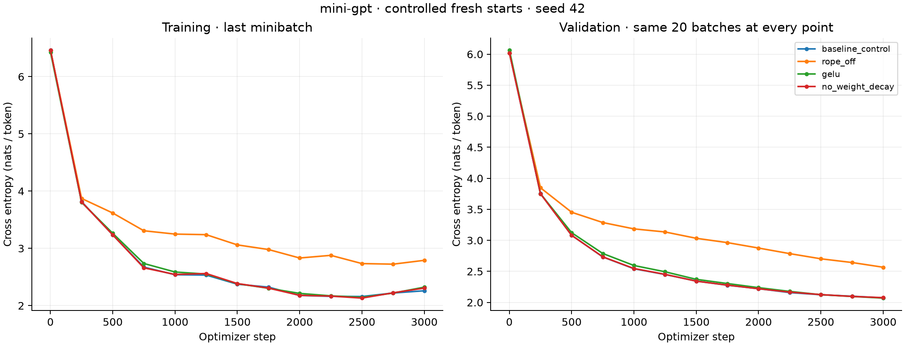
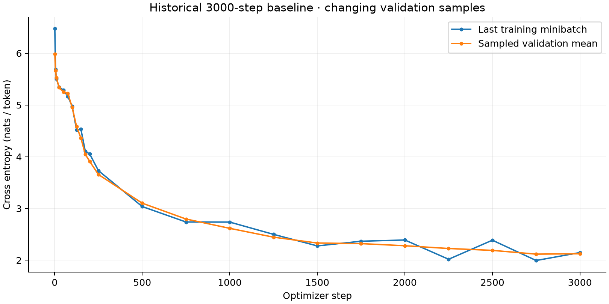

# Experimental results

All four formal runs completed 3000 fresh-start updates on CPU. Values are read directly from tracked CSVs; final checkpoints and hashes verified.

| Variant | Final train | Final validation | Δ validation vs control | Best validation (step) | Token PPL |
|---|---:|---:|---:|---:|---:|
| baseline_control | 2.25881 | 2.07283 | +0.00000 | 2.07283 (3000) | 7.947 |
| rope_off | 2.79081 | 2.56650 | +0.49367 | 2.56650 (3000) | 13.020 |
| gelu | 2.32207 | 2.06949 | -0.00334 | 2.06949 (3000) | 7.921 |
| no_weight_decay | 2.30541 | 2.07643 | +0.00360 | 2.07643 (3000) | 7.976 |

Historical baseline: final train 2.14841; final validation 2.12550; lowest recorded validation 2.11852 at step 2750. The CSV retains all 23 historical rows unchanged. Its resumed RNG and validation protocol differ from the controlled suite, so use the fresh control for ablation comparisons.

## Analysis

RoPE-off finishes +0.49367 nats/token above the matched control, a substantial deterioration in this run. GELU changes final validation loss by -0.00334; zero decay changes it by +0.00360. These small latter differences are insufficient to claim a reliable improvement or harm from one seed. Retaining RoPE is supported by this paired run; activation and weight-decay choices remain unresolved without replication.

Positive validation deltas mean worse loss than the matched control. Disabling RoPE removes explicit positional encoding from Q/K; causal masking remains. GELU changes only the FFN nonlinearity. Zero weight decay changes only the AdamW decay coefficient. These comparisons hold data, initial weights, sampled training windows, evaluation windows, steps, and optimizer settings constant.

One paired seed and 20 fixed validation minibatches do not support statistical significance claims. Training curves report individual minibatches and are noisy. Validation uses overlapping windows sampled with replacement, not the entire held-out corpus. Do not infer a robust train/validation gap from these mismatched estimators. Perplexity is token-level exp(loss) for this 513-token vocabulary.

## Status and deferred work

- Completed: preserved historical baseline; fresh control; RoPE-off, GELU, and no-weight-decay runs; plots and checkpoint verification.
- Verification only: tiny two-step runs, repeatability runs, and ten-step full-model benchmark, excluded from this table.
- Planned: repeated seeds and full-validation evaluation. No results claimed.
- Three research papers: deferred to Week 2 Day 5 at the user’s direction.
- Foundation Gate: deferred until teachers are available.

Run `python plot_results.py` to regenerate this report, summary.csv, and both plot formats from the raw logs and local checkpoints.
